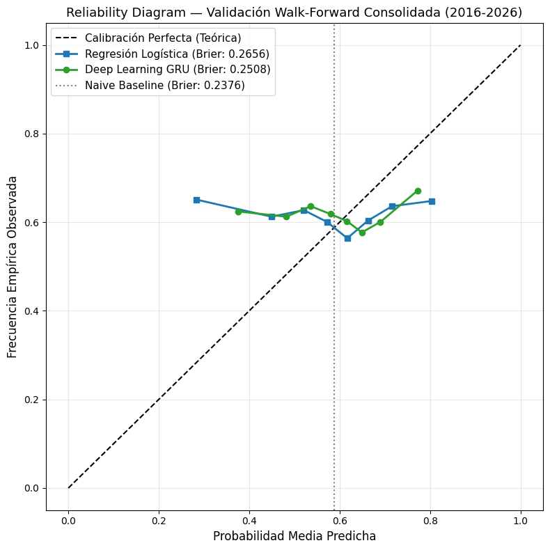

# Redes recurrentes frente a modelos clásicos en la predicción probabilística de SPY a cinco ruedas

Trabajo Práctico Final · **Redes Neuronales y Deep Learning** · Maestría en Inteligencia Artificial · Universidad de Palermo
Grupo 4: Diego Diamanti, Melisa Maldonado y Diego Weber · Octubre de 2026

## Pregunta de investigación

¿Puede una red neuronal recurrente (GRU) estimar la probabilidad de que el retorno de SPY a cinco ruedas sea positivo, a partir de ventanas de 20 ruedas, con mejor calibración que una regresión logística regularizada y que una línea de base ingenua, bajo validación walk-forward?

## Resultados principales

Evaluación fuera de muestra entre 2016 y 2026, con 2.703 ruedas en cuatro bloques walk-forward. Los valores son promedios ponderados por la cantidad de ruedas de cada bloque.

| Modelo | Exactitud | AUC-ROC | Brier | BSS |
|---|---|---|---|---|
| Línea de base ingenua | 61,8% | 0,500 | **0,2376** | 0,0% |
| Regresión logística | 55,1% | 0,519 | 0,2656 | −12,0% |
| GRU | 56,4% | 0,513 | 0,2508 | −5,5% |

Diferencias con intervalo de confianza del 95%, estimado por bootstrap por bloques:

| Comparación | Diferencia | IC 95% | ¿Significativa? |
|---|---|---|---|
| AUC: GRU − logística | +0,005 | [−0,037; +0,046] | No |
| Brier: GRU − logística | −0,0148 | [−0,0281; −0,0026] | Sí, a favor de la GRU |
| Brier: GRU − línea de base | +0,0133 | [+0,0066; +0,0204] | Sí, a favor de la línea de base |

- **Ningún modelo supera a la línea de base**, que predice siempre la frecuencia histórica de subas (alrededor del 60%).
- **La GRU calibra mejor que la regresión logística, pero no discrimina mejor.** Su ventaja viene de concentrar sus probabilidades cerca de la frecuencia de subas.

## Contenido del repositorio

| Archivo | Descripción |
|---|---|
| `notebook/Deep_Market_Representation_Learning_GRU_SPY.ipynb` | Notebook ejecutado de punta a punta, con todas las salidas |
| `informe/Informe_Final_TP_Deep_Learning_UP.docx` | Informe académico |
| `presentacion/Presentacion_TP_Deep_Learning_UP.pptx` | Presentación de 20 diapositivas, con notas del orador |
| `presentacion/Guion_Presentacion_Oral_Grupo4.docx` | Guion de la defensa oral (9:40 min) |
| `figuras/` | Figuras usadas en el informe y la presentación |
| `requirements.txt` | Versiones de las librerías en la ejecución reportada |

## Metodología en breve

- **Datos:** nueve ETF (SPY, QQQ, IWM, TLT, HYG, GLD, USO, XLE, XLK) y el índice VIX, descargados de yfinance desde mayo de 2007. Esa es la primera fecha con cotización común de todos los activos.
- **Variables:** 78 variables estacionarias (retornos, momentum, volatilidad, razones relativas y VIX), sin niveles de precio.
- **Objetivo:** variable binaria que vale 1 si el retorno de SPY entre t y t + 5 es positivo.
- **Validación:** walk-forward con ventana expansiva en cuatro bloques de prueba (2016–2018, 2019–2021, 2022–2024 y 2025–2026). Incluye purga de 5 ruedas y escalado ajustado solo con datos de entrenamiento.
- **Modelos:** línea de base ingenua, regresión logística L2 y una GRU de 32 unidades con 11.993 parámetros.
- **Métricas:**
  - puntaje de Brier, Brier Skill Score, AUC-ROC y diagramas de confiabilidad;
  - bootstrap por bloques para estimar la significancia de las diferencias;
  - simulación económica con medio Kelly y costos de 5 pb.

## Cómo reproducir

1. Abrir el notebook en [Google Colab](https://colab.research.google.com), con entorno CPU.
2. Ejecutar todas las celdas en orden (*Entorno de ejecución → Ejecutar todas*). La primera celda instala las dependencias.
3. La última celda guarda `reproducibility_manifest.json` con las versiones usadas.

La semilla es 42 y las operaciones de TensorFlow son deterministas. Los resultados pueden variar levemente según la fecha de descarga de los datos.

## Limitaciones

- Un solo activo, un solo horizonte y una sola semilla.
- La parada temprana monitorea la pérdida de validación y no se activó en ningún bloque. Mientras tanto, el AUC de validación cae desde la primera época.
- yfinance no es una fuente oficial de datos.

## Aviso

Trabajo académico. No constituye asesoramiento de inversión.
